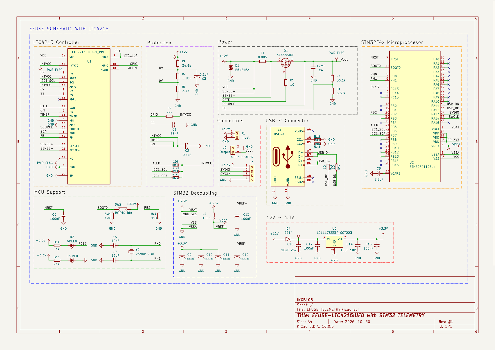
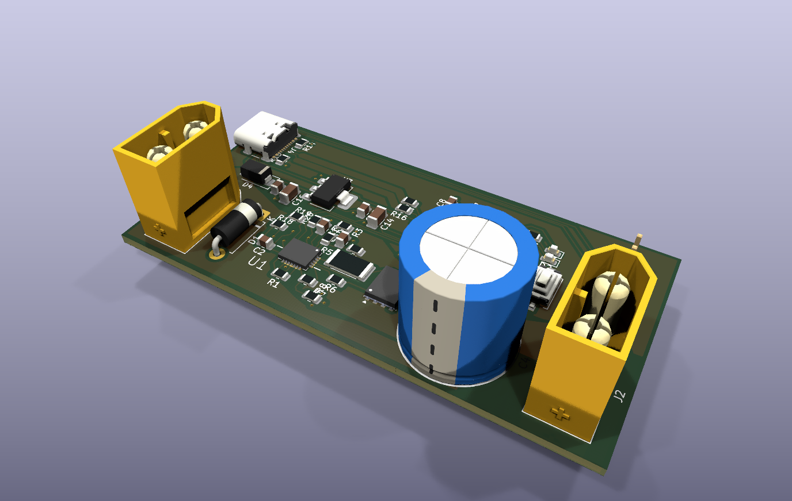
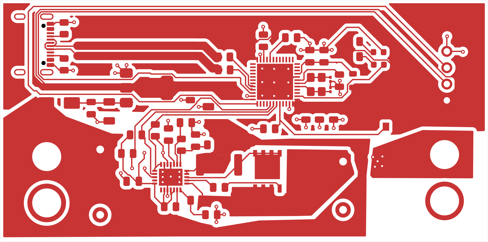
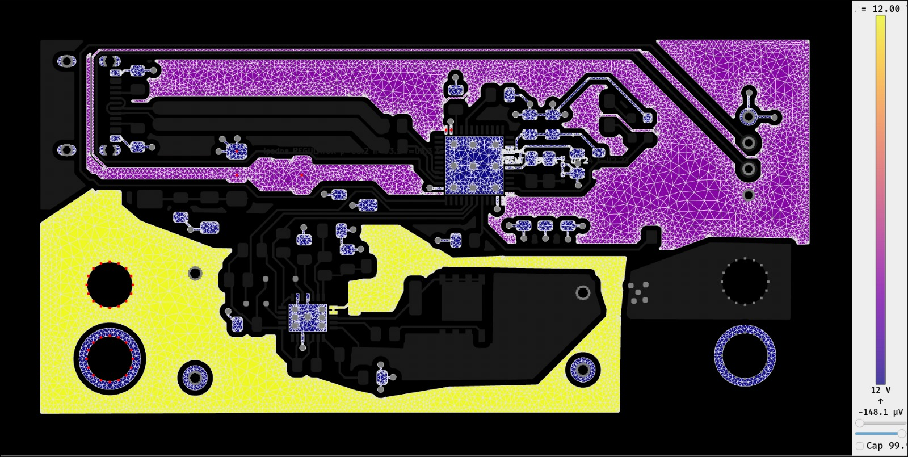

# Hot-Swap eFuse Telemetry (LTC4215 + STM32F411CEU6)

Digital telemetry front-end for the [EFUSE-LTC4215-HotSwap](https://github.com/IKGB105/EFUSE-LTC4215-HotSwap)
board: adds a minimal STM32F411CEU6 system wired to the LTC4215's I²C/SMBus monitoring interface,
which the original design left completely unused. Same honest-engineering-logbook documentation
style as the rest of the series — every result marked calculated, simulated, or pending, no invented
placeholders.

- **Why:** the LTC4215 has an onboard ADC and I²C register map for current/voltage/fault monitoring
  that the original eFuse project never touched. This project closes that gap instead of starting an
  unrelated MCU exercise.
- **MCU:** STM32F411CEU6 (same part as the WeAct "Blackpill"), chosen for native USB-DFU flashing and
  headroom for future command parsing — not just familiarity.
- **Scope:** schematic + PCB layout only, same convention as every project in this series. Not
  physically built.

> ⚠️ **The LTC4215 is not PMBus-compliant.** It has its own proprietary I²C register map, not the
> standardized PMBus command set — described here as "digital power monitoring in the spirit of
> PMBus," not as a PMBus device, to avoid overstating the IC.

<table>
<tr>
<td><br><sub>KiCad — schematic</sub></td>
<td><br><sub>KiCad — PCB 3D render</sub></td>
<td><br><sub>KiCad — top copper routing</sub></td>
</tr>
</table>

## I²C integration with the LTC4215

The original eFuse board left every I²C-related pin (SCL, SDAI, SDAO, ADR0-2) no-connect. This
revision wires them per the datasheet:

- **SDAI + SDAO tied together** to form the bidirectional SDA line (the QFN exposes them separately
  only to allow an optoisolator on SDAO alone — not used here).
- **Address set to 19** (`ADR2`/`ADR0` to INTVCC, `ADR1` floating) — reproduced from the datasheet's
  own worked example (Figure 5), not an arbitrary value, since it's the only device on the bus.
- **Pull-ups referenced to INTVCC** (≈3.1 V typ, confirmed from the datasheet's electrical table to
  be close enough to 3.3 V logic that no level shifter is needed): 4.7 kΩ on SCL/SDA, 10 kΩ on ALERT.
- **-ALERT**, previously unused, now routed to the STM32 as an EXTI interrupt source.

## STM32 minimal system

Built from the real WeAct Blackpill reference schematic (`docs/reference/`), kept where it was
correct and corrected where it was not — see the report's pitfalls section for specifics:

- 3× VDD + 4× VSS (the UFQFPN48's exposed pad is a 4th, hidden VSS pin stacked on the visible one —
  verified directly from the symbol library file, not assumed).
- VCAP1 (2.2 µF, required for the F4's internal core regulator) and a VDDA/VREF+ LC filter.
- 25 MHz/9 pF crystal, 12 pF loading caps — **no RTC crystal/battery**, intentionally dropped (not
  needed for I²C telemetry).
- BOOT0 **and BOOT1** (shared with PB2 on the F401/F410/F411/F412 value line) pull-downs — confirmed
  against RM0383 §2.4 that BOOT1 is real on this part, not an F1-series leftover as first assumed.
- USB-C with a properly impedance-controlled D+/D− differential pair (90.2 Ω, computed from this
  board's real 2-layer stackup, not a generic assumption) and independent CC1/CC2 pull-downs.
- Single-stage **12 V → 3.3 V** LDO (LD1117S33TR) direct from the eFuse's +12 V rail — not the real
  Blackpill's two-stage USB-fed supply, since this board is never USB-powered.

## Firmware

I²C driver for the LTC4215 (`code/EFUSE_TELEMETRY/Core/{Inc,Src}/ltc4215.c,h`), on a STM32CubeMX
skeleton (I2C1 on PB6/PB7, USB\_OTG\_FS device-only with VBUS sensing disabled, USB\_DEVICE as
CDC/Virtual COM Port). Register map (CONTROL/ALERT/STATUS/FAULT/SENSE/SOURCE/ADIN, 00h-06h) and LSB
values taken straight from the datasheet's Tables 2-8, not re-derived. Main loop polls every 500 ms
and streams output current/voltage/fault flags over USB-CDC.

**Verified without any physical board, two ways:**
- Compiles clean against the real HAL — CMake + `arm-none-eabi-gcc`, 0 errors/warnings, 36020 B FLASH
  (6.87%), 9456 B RAM (7.21%).
- The register-to-physical-value math is checked on the **host** (plain `gcc`, no STM32 hardware) in
  [`code/test/ltc4215_regmap_test.c`](code/test/ltc4215_regmap_test.c) against synthetic bytes derived
  from the datasheet's LSB values — 11/11 checks pass.

Neither claims real I²C traffic with a physical LTC4215 — this board was never built.

## Repository structure

```
docs/         LaTeX report (efuse_telemetry_stm32.tex) + datasheet + WeAct reference schematic
kicad/        KiCad project — schematic + PCB, ERC/DRC clean
code/         STM32CubeMX project (CMake) + LTC4215 driver + host-side unit test
```

## Document

The full report (MCU selection rationale, I²C integration design, STM32 minimal-system design, PCB
layout decisions, and every pitfall found along the way — net-name collisions, hidden/stacked pins,
4-pad crystal footprints, differential pair impedance synthesis, a confirmed BOOT1 requirement) is in
[`docs/efuse_telemetry_stm32.pdf`](docs/efuse_telemetry_stm32.pdf) — compiled and committed. Source
is [`docs/efuse_telemetry_stm32.tex`](docs/efuse_telemetry_stm32.tex) if you want to edit or
recompile it yourself (`pdflatex`).

## PCB (KiCad)

In [`kicad/EFUSE_TELEMETRY/`](kicad/EFUSE_TELEMETRY/) — ERC and DRC both clean (the only remaining
DRC entries are inherent to the USB-C connector footprint itself: hole clearance to its own mounting
holes, and the four intentionally-No-Connect VBUS pads touching each other). Single sheet, organized
into labeled blocks (Controller, Protection, Power, Connectors, STM32 Microprocessor, MCU Support,
STM32 Decoupling, USB-C, 12V→3.3V) rather than hierarchical sheets — the board is small enough that
visual grouping is clearer.

## PDN analysis

<br>
<sub>padne — DC voltage distribution: 12V eFuse input (yellow/red) and the 3.3V/GND plane under the
STM32's 50mA load (purple), at most 148µV of drop.</sub>

DC voltage-drop check done with [`padne`](https://github.com/atx/padne) (built from source — needs
`boost` dev headers for its CGAL dependency): under the STM32's estimated 50 mA load, the 3.3 V/GND
plane shows at most **148 µV** of drop — the copper is far from the bottleneck at this current level.
`!padne` directives live as plain text in the schematic, not the PCB. Full write-up (including the
`REGULATOR`+`CURRENT` solver interaction that made the LDO need modeling as a plain ideal source
instead) in the report.

AC impedance-vs-frequency sweep (the actual question for a digital decoupling bank — DC drop is blind
to capacitors entirely) is planned with [KiPI](https://github.com/drewsum/KiPI) — installed and
loading the board, but the probe/sweep setup wasn't finished this session.

## License

MIT — see [LICENSE](LICENSE).
